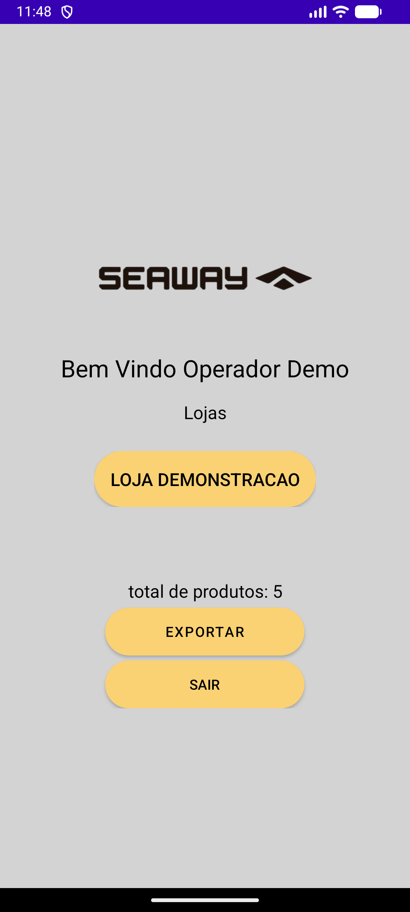
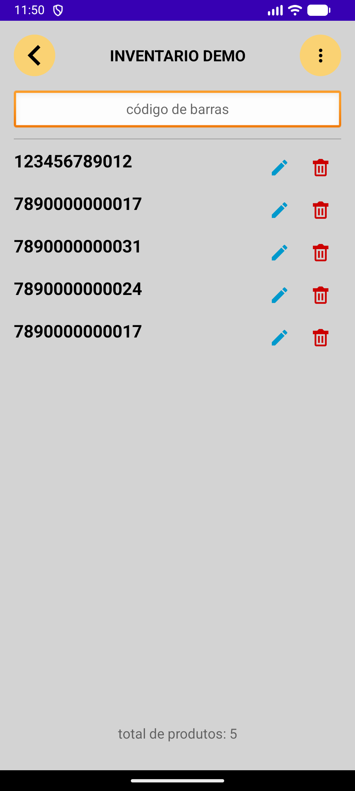
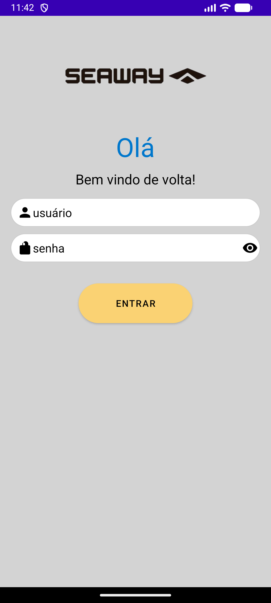
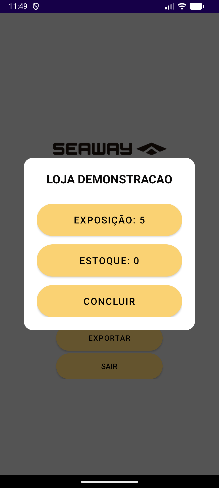
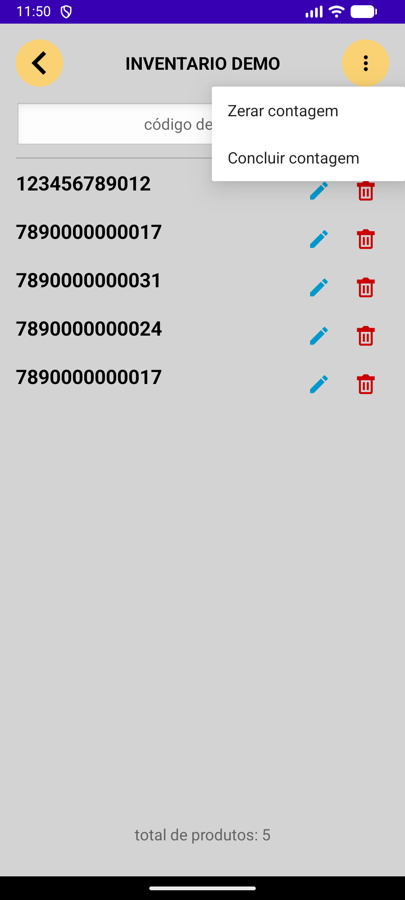
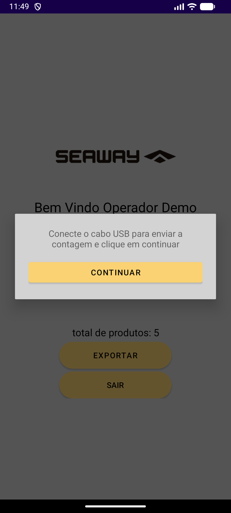

# Seaway · Leitor-SW
### Contagem de estoque nos coletores Android

**Uma entrega profissional desenvolvida por dois integrantes, da interface ao arquivo de contagem.**

*Aplicativo real executado no emulador Android. Usuário, loja, sessões e códigos usados nas imagens são fictícios.*

## Contexto

O aplicativo foi desenvolvido para os coletores utilizados pela equipe responsável pela gestão de estoque da Seaway. A operação precisava organizar contagens por loja e sessão, registrar códigos de barras e disponibilizar os dados para o fluxo de trabalho seguinte.

## Meu papel

Atuei como **desenvolvedor freelance**, em dupla com um colega. Nós dois participamos de todas as frentes da solução: interface Android, dados locais, regras de permissões, contagens, exportação e sincronização.

Desenvolvi o projeto entre **junho e agosto de 2024**, com uma versão entregue para a equipe de estoque da Seaway. As imagens abaixo foram capturadas numa execução local com dados fictícios.

## A solução

| Fluxo | O que foi construído |
|---|---|
| Administração | Cadastro de lojas, usuários e permissões |
| Acesso operacional | Visão do operador e lojas/sessões autorizadas |
| Contagem | Registro de códigos de barras por sessão de estoque ou exposição |
| Persistência | Room/SQLite no dispositivo, com operação local/offline |
| Saída de dados | Exportação em formato DBF |
| Transferência | Sincronização via Bluetooth e compartilhamento do arquivo para envio por e-mail |

## Percurso visual

### Acesso, seleção e registro

<table>
<tr>
<th>1. Acesso ao coletor</th>
<th>2. Sessões da loja</th>
<th>3. Contagem de produtos</th>
</tr>
<tr>
<td></td>
<td></td>
<td></td>
</tr>
</table>

O operador acessa a loja e escolhe o contexto da contagem. Na demonstração, uma leitura fictícia de 12 dígitos foi inserida pelo campo de código de barras: o registro apareceu na lista e o total passou de **4 para 5**. Ao retornar ao painel, o total continuou atualizado.

### Ações e saída dos dados

As ações da sessão permitem concluir ou reiniciar a contagem. A interface também oferece o fluxo de exportação e orienta a conexão USB. As capturas param antes da transferência: nenhum arquivo foi enviado por e-mail ou para dispositivos externos.

## Decisões técnicas

### Android nativo em Kotlin

A aplicação foi construída com Android SDK, Activities, DialogFragments, layouts XML e View Binding. Isso permite trabalhar diretamente com as APIs da plataforma utilizadas pelos dispositivos de coleta.

### Dados locais com Room

As entidades principais representam usuário, loja, sessão, permissão e leitura de código de barras. O armazenamento local permite registrar contagens sem depender de um backend centralizado durante o uso.

### Permissões por contexto

O acesso não se resume ao perfil Master ou Usuário: existem vínculos entre usuário, loja e sessão. Essa estrutura organiza quais contagens podem ser acessadas por cada operador.

### DBF e Bluetooth

A exportação DBF atende ao formato previsto no fluxo de saída do projeto. O Bluetooth oferece um caminho de transferência entre dispositivos. Esses mecanismos não devem ser confundidos com sincronização permanente em nuvem.

## Resultado

Entrega de aplicativo para uso pela equipe de estoque, com desenvolvimento em dupla e participação nas diferentes camadas da solução. Nesta execução local, foi verificado o registro de uma nova leitura e a atualização do total ao retornar ao painel. Não há métricas históricas de ganho de produtividade disponíveis para este estudo.

## Stack

**Kotlin · Android SDK · Activities/DialogFragments · View Binding · Material Components · Coroutines · Room/SQLite · DBF · Bluetooth**

## Como esta demonstração foi preparada

O projeto original foi copiado para um ambiente isolado. A configuração de build foi ajustada nessa cópia para compilar o módulo raiz com as fontes existentes, usando Gradle 8.11.1, JDK 17 e Android SDK 34. Nenhuma dessas adaptações foi enviada ao repositório privado.

Uma loja, um operador, sessões e leituras fictícias foram adicionados exclusivamente à base de demonstração. O emulador representa o Android para captura das telas. A leitura foi simulada por entrada de texto; o leitor físico do coletor, a transferência USB, o Bluetooth e o envio por e-mail não foram testados nesta execução.

---

**Autores do estudo:** [Marco Maciel](https://github.com/oMarcoMaciel) · [João Victor](https://github.com/joaovictorrio)

Este repositório contém documentação visual e explicações do projeto. O código da aplicação, APK, credenciais e dados operacionais não são publicados aqui.
